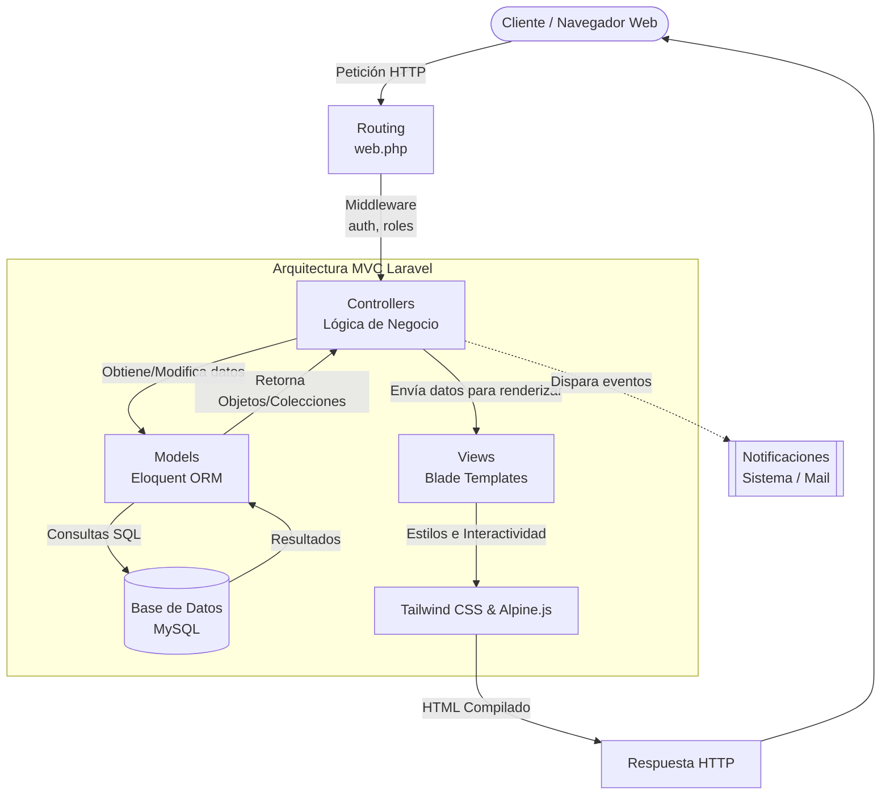
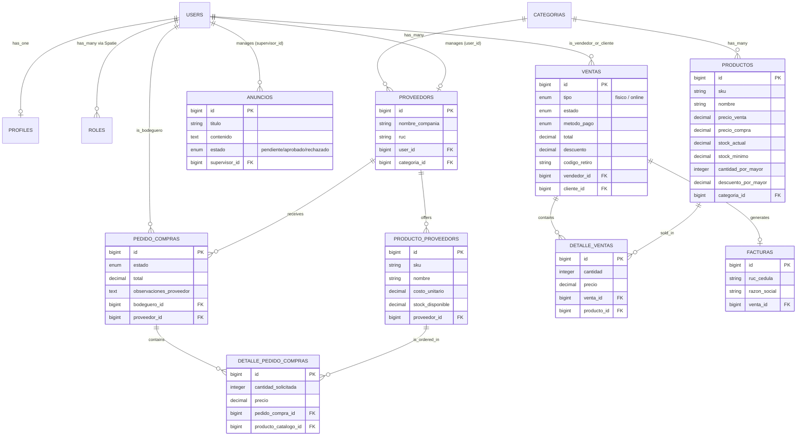

# FerrEcom - Sistema de Gestión y Comercio Electrónico Ferretero

FerrEcom es una plataforma integral diseñada para la gestión completa de una ferretería. Combina un robusto sistema de punto de venta (POS) y administración de inventarios con una moderna tienda en línea (E-commerce). Permite controlar desde las compras a proveedores y niveles de stock, hasta la facturación física y las ventas por internet con retiros en tienda.

---

## 🛠️ Stack Tecnológico

El sistema está construido utilizando tecnologías modernas para asegurar escalabilidad, seguridad y una experiencia de usuario fluida:

- **Backend:** Laravel (PHP)
- **Base de Datos:** MySQL / MariaDB
- **Frontend / UI:** Blade Templates, Tailwind CSS (para diseño premium y responsive)
- **Interactividad Frontend:** Alpine.js (para carritos de compra y modales reactivos) y JavaScript Vanilla
- **Manejo de Roles:** Spatie Laravel Permission
- **Iconografía:** FontAwesome 6

---

## 🧩 Módulos del Sistema

La arquitectura de FerrEcom está dividida en los siguientes módulos principales:

### 1. Módulo de Usuarios y Roles (RBAC)
Gestiona el acceso al sistema utilizando `spatie/laravel-permission`. 
- **Roles principales:** Dueño, Administrador, Bodeguero, Vendedor, Cliente y Proveedor.
- **Perfiles (`profiles`):** Información detallada del usuario (RUC/Cédula, dirección, teléfono).

### 2. Módulo de Inventario (Catálogo Interno)
- Gestión de `productos` con control de `stock_actual` y `stock_minimo`.
- Precios de venta, costos de compra, e imágenes.
- Configuración de **ventas al por mayor** (cantidad mínima y porcentaje de descuento).
- **Alertas de Bajo Stock:** Notificaciones automáticas enviadas a los administradores/dueños/bodegueros cuando un producto baja de su stock mínimo durante una venta.

### 3. Módulo de Proveedores y Catálogos Externos
- Registro de `proveedors` con sus datos comerciales.
- **Catálogo de Proveedor (`producto_proveedors`):** Productos específicos que oferta cada proveedor con sus respectivos costos y stock disponible.

### 4. Módulo de Reabastecimiento (Pedidos de Compra)
Flujo de 5 pasos para reponer el inventario:
1. **Pendiente:** El bodeguero o dueño genera el pedido hacia un proveedor (incluso pre-llenado automáticamente desde la alerta de bajo stock).
2. **Revisado:** El proveedor revisa la solicitud y valida su inventario (puede marcar "stock incompleto" dejando observaciones).
3. **Confirmado:** El ferretero ajusta o acepta las condiciones del proveedor.
4. **Enviado:** El proveedor despacha la mercadería.
5. **Completado / No Recibido:** El bodeguero marca la recepción del pedido, lo cual alimenta el `stock_actual` automáticamente.
*Nota:* Puede ser Cancelado en las etapas iniciales.

### 5. Módulo de Ventas (Punto de Venta / POS)
- Pantalla para ventas físicas directas (`ventas` de tipo `fisico`).
- Búsqueda de clientes por Cédula/RUC y creación dinámica de facturas.
- Disminución de stock instantánea.

### 6. Módulo de E-commerce (Tienda en Línea)
- Vitrina virtual para clientes visitantes.
- **Carrito de Compras:** Persistente en `localStorage` (gestionado con Alpine.js), requiere inicio de sesión para concretar pagos.
- **Checkout:** Permite realizar pedidos en línea (`ventas` de tipo `online`), genera un `codigo_retiro` (ej. `ONL-X8A9F2`) y notifica al cliente por correo/sistema.
- Panel de "Mis Compras" exclusivo para clientes.

### 7. Módulo de Facturación
Generación automática de comprobantes (`facturas`) asociadas a cada venta física o en línea, almacenando razón social, dirección y detalles impositivos.

### 8. Módulo de Anuncios y Promociones
- Gestión de contenido publicitario y anuncios (`anuncios`).
- Tienen un flujo de aprobación basado en `estado` (pendiente, aprobado, rechazado).
- Cada anuncio está vinculado al administrador o supervisor (`supervisor_id`) que lo gestiona y es visualizado por los clientes en la tienda en línea.

### 9. Módulo de Reportes y Estadísticas (Dashboard)
- Consolida la información operativa de la ferretería en un panel administrativo.
- Presenta KPIs en tiempo real (Total de ventas, productos con bajo stock, pedidos pendientes).
- Cruza datos de los módulos de Ventas, Inventario y Reabastecimiento para ofrecer visualizaciones y métricas útiles para la toma de decisiones gerenciales.

---

## 🏛️ Arquitectura del Sistema

El proyecto sigue el patrón **MVC (Model-View-Controller)** propio de Laravel.

- **Routing:** Definición clara en `web.php` separada por grupos de middleware (`auth`, `role:Bodeguero|Administrador`, etc.).
- **Controllers:** Lógica de negocio encapsulada (ej. `PedidoCompraController`, `TiendaController`, `VentaController`).
- **Models:** Modelos Eloquent con relaciones definidas.
- **Views:** Componentes de Blade estructurados en `layouts` (`admin`, `app`) y organizados por carpetas funcionales (`admin/productos`, `tienda/`, `admin/pedidos/`).
- **Notifications:** Uso de los canales de notificación de Laravel (Base de datos y Mail) para eventos críticos (Bajo Stock, Ventas Realizadas).

---

## 📊 Diagrama de Base de Datos (ERD)

A continuación se muestra el diagrama Entidad-Relación de las tablas principales que rigen la lógica de FerrEcom:

> **Nota sobre el Módulo de Reportes:** Como se observa en el diagrama, el Módulo de Reportes y Estadísticas no posee tablas físicas propias. Este funciona de manera *lógica*, realizando consultas y agregaciones dinámicas sobre las tablas transaccionales existentes (`VENTAS`, `PEDIDO_COMPRAS`, `PRODUCTOS`) para generar los tableros de control (dashboards) en tiempo real.
